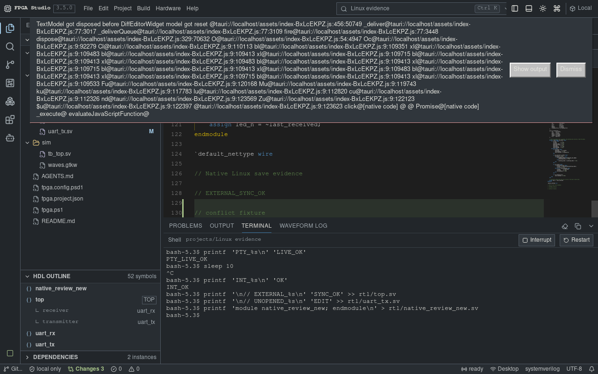
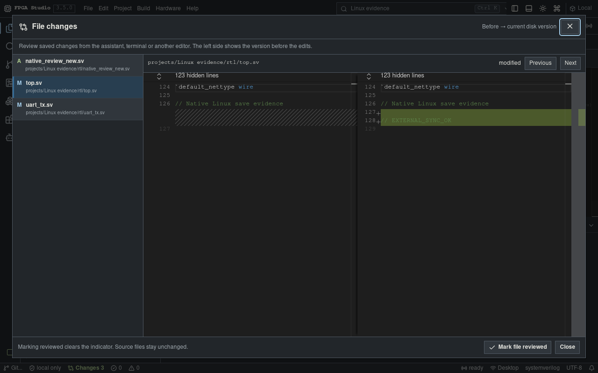
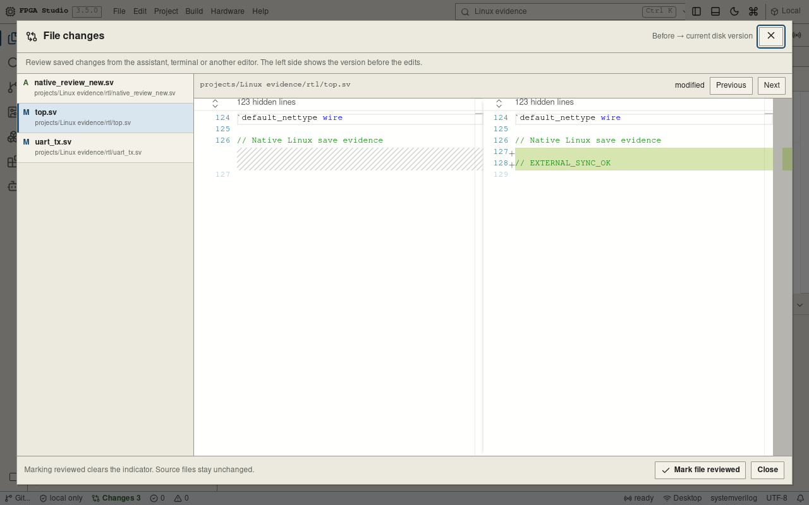

# Tang FPGA Studio

An open-source FPGA workbench for Sipeed Tang boards, available on Windows and
Ubuntu 22.04 or newer. Write Verilog and SystemVerilog, simulate, inspect
waveforms, build a bitstream and program your board from one workspace.

[Download releases](https://github.com/atmarachchige0081/Tang-FPGA-Studio/releases/latest) ·
[Installation](INSTALL.md) · [Ubuntu setup](docs/LINUX.md) ·
[AI assistant](docs/AI_ASSISTANT.md) · [Changelog](CHANGELOG.md)



## Get started

**Windows:** the [one-file installer](https://github.com/atmarachchige0081/Tang-FPGA-Studio-Installer/releases/latest)
sets up the app and offers the FPGA toolchain. Check its version matches the
Studio release; installer publication runs separately. The Studio release also
provides the native application installer. Follow [INSTALL.md](INSTALL.md) for
first-board setup. Unsigned installers may display an Unknown publisher prompt.

**Ubuntu:** download the x86_64 `.deb` or AppImage from the release, then follow
[the Linux guide](docs/LINUX.md) for system libraries, PowerShell 7, FPGA tools
and USB permissions. Linux uses udev/libusb for JTAG and dialout for serial access.
The application packages do not bundle the FPGA toolchain.

Choose **New project** for a board-specific example, or **Open project folder**
(`Ctrl+O`) for an existing Studio project. Build and simulate before programming.
Use SRAM upload for the normal test loop; Flash writes persistent configuration.

## The workspace

- Verilog/SystemVerilog editing with project symbols, diagnostics, navigation,
  module-port completion and optional AI inline suggestions.
- A real PowerShell or Bash terminal, separate build output and resizable panels.
- Live file updates from external tools, with explicit choices when unsaved edits conflict.
- Native before/after review for saved changes, including files changed by an AI.
  Changes remain marked until reviewed; this journal resets when the app restarts.
- Optional Codex assistant with your own account, project context, approvals,
  steering and stop controls. Normal editing and FPGA tools need no AI account.
- Simulation, waveforms, netlist inspection, implementation reports, JTAG,
  UART and an SRAM-only on-chip analyzer.

Dark and light themes use the same compact layout. Drag panel dividers to resize;
double-click a divider to reset it.

| Review saved file changes | Light theme |
|---|---|
|  |  |

These screenshots show the native Linux application exercising a local test
project. They demonstrate the UI, not a connected board or an authenticated AI response.

## Supported boards

| Board package | FPGA | Programmer alias | Build route / pin package |
|---|---|---|---|
| Tang Nano 1K | `GW1NZ-LV1QN48C6/I5` | `tangnano1k` | Open-source build |
| Tang Nano 4K | `GW1NSR-LV4CQN48PC6/I5` | `tangnano4k` | Open-source build |
| Tang Nano 9K | `GW1NR-LV9QN88PC6/I5` | `tangnano9k` | Open-source build; UART pin package |
| Tang Nano 20K | `GW2AR-LV18QN88C8/I7` | `tangnano20k` | Open-source build; UART pin package |
| Tang Primer 20K + Dock | `GW2A-LV18PG256C8/I7` | `tangprimer20k` | Open-source build; Dock JTAG/UART and I/O profile |
| Tang Primer 20K Core / Lite | `GW2A-LV18PG256C8/I7` | `tangprimer20k` | Open-source build; carrier pins user-defined |
| Tang Console 60K | `GW5AT-LV60PG484AC1/I0` | `tangconsole` | Gowin EDA required for place/route |
| Tang Console 138K (C revision) | `GW5AST-LV138PG484AC1/I0` | `tangmega138k` | Open-source build with `GW5AST-138C` database |

Board packages describe supported build targets and pin mappings, not physical
acceptance of every board. Check your board revision and carrier before using
constraints. Console 60K requires Gowin EDA; other listed targets use the pinned
[OSS CAD Suite](https://github.com/YosysHQ/oss-cad-suite-build).

For the Primer 20K Dock, enable the core with DIP switch 1 down and connect the
Dock's **JTAG/UART** USB-C port. On Windows, WinUSB belongs on **Interface 0 / MI_00**
only; keep Interface 1's serial driver for UART. See [installation](INSTALL.md).

## Learn and contribute

Start with the [button/LED lesson](projects/01_button_led_pwm),
[UART example](projects/03_uart_terminal), or
[serial command console](projects/05_serial_command_console).
The [IDE guide](ide/README.md) covers everyday commands and shortcuts.

Contributors need Node.js 24, Rust and the platform's Tauri prerequisites:

```sh
cd studio
npm ci
npm run desktop
```

See [Contributing](CONTRIBUTING.md), [deployment and checks](docs/DEPLOYMENT.md),
[validation scope](docs/LINUX_VALIDATION.md) and [security reporting](SECURITY.md).
Source code is available under the [MIT license](LICENSE).
